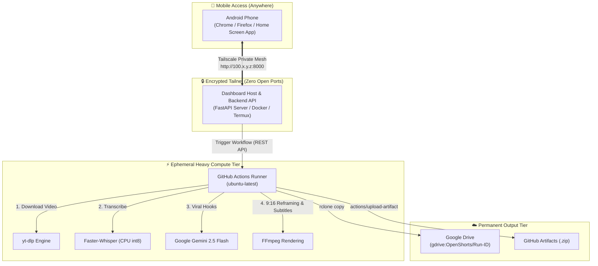

# ⚡ OpenShorts Automation with Tailscale Dashboard Access

> **Turn YouTube videos into viral 9:16 Shorts, Reels, and TikToks from your Android phone over a secure private Tailscale network, powered by GitHub Actions and automatically synced to Google Drive.**

[](LICENSE)
[](.github/workflows/openshorts.yml)
[](https://tailscale.com)
[](https://rclone.org)
[](https://ai.google.dev)

---

## 🎯 System Overview

This system provides a complete, self-hosted, cloud-orchestrated video automation pipeline:

1. **Android Dashboard via Tailscale**: Access your private, mobile-optimized dashboard from anywhere using Tailscale WireGuard® mesh encryption — **zero open ports, zero public IP exposure**.
2. **Ephemeral GitHub Actions Processing**: Heavy video download, audio transcription, AI moment detection, and FFmpeg 9:16 video rendering run on GitHub Actions runners on-demand — **zero server compute costs**.
3. **Google Drive Permanent Storage**: Generated shorts and metadata JSON are automatically synced to your Google Drive via `rclone` and archived as GitHub Actions artifacts.



---

## 📋 Required GitHub Repository Secrets

Configure these secrets in your repository under **Settings → Secrets and variables → Actions**:

| Secret Name | Required | Description | How to Obtain / Configure |
| :--- | :---: | :--- | :--- |
| `GEMINI_API_KEY` | **Yes** | Google Gemini API Key for viral moment detection & hook generation | Get free from [Google AI Studio](https://aistudio.google.com/app/apikey) |
| `RCLONE_CONFIG_DATA` | **Yes** | Base64-encoded `rclone.conf` containing your Google Drive remote | Run `./scripts/export_rclone_secret.sh` (or base64 encode `~/.config/rclone/rclone.conf`) |
| `YT_COOKIES` | Optional | Netscape format cookies for YouTube (if bypassing bot checks) | Export cookies from browser extension |

---

## 🚀 Quickstart Guide

### Step 1: Export Your Existing Google Drive Remote to GitHub Secrets

Since you already have a configured `rclone` remote named `gdrive:`, run the safe exporter script:
```bash
./scripts/export_rclone_secret.sh
```
*This command reads `~/.config/rclone/rclone.conf`, encodes it to base64, and safely sets `RCLONE_CONFIG_DATA` in your GitHub repository without printing any passwords to the terminal.*

---

### Step 2: Configure the Dashboard Host

You can run the dashboard on any always-on machine: a Linux VPS (Oracle Cloud Free Tier, Hetzner, AWS), a home server, or local Termux environment.

1. **Install Tailscale on the host**:
   ```bash
   curl -fsSL https://tailscale.com/install.sh | sh
   sudo tailscale up
   ```
2. **Find the host's Tailscale IP**:
   ```bash
   tailscale ip -4
   # Example: 100.85.12.34
   ```
3. **Configure Environment**:
   ```bash
   cp .env.example .env
   ```
   Edit `.env` and set your `GITHUB_TOKEN` (Personal Access Token with `workflow` scope):
   ```ini
   GITHUB_TOKEN=ghp_yourPersonalAccessTokenHere
   GITHUB_OWNER=mystxnavadeep
   GITHUB_REPO=openshorts-automation
   HOST=0.0.0.0
   PORT=8000
   ```
4. **Install backend dependencies and run**:
   ```bash
   pip install -r backend/requirements.txt
   ./backend/run.sh
   ```

*(Alternatively, use Docker: `cd deploy && docker compose up -d`)*

---

### Step 3: Connect from Your Android Phone via Tailscale

1. Install the official **Tailscale** app on your Android phone from [Google Play Store](https://play.google.com/store/apps/details?id=com.tailscale.ipn).
2. Log in with the **same Tailscale account** as your host.
3. Toggle the Tailscale switch to **Connected**.
4. Open Chrome or Firefox on your Android phone and navigate to:
   ```text
   http://100.x.y.z:8000
   ```
   *(Replace `100.x.y.z` with your host's Tailscale IP address)*
5. **Tip**: Tap Chrome's menu (⋮) → **"Add to Home screen"** to install the dashboard as an Android web app!

---

## 🎬 How to Use the Dashboard

1. **Paste YouTube URL**: Tap the **📋 Paste** button to insert any YouTube URL.
2. **Choose Settings**:
   - **Aspect Ratio**: 9:16 Vertical (Shorts/TikTok/Reels), 1:1 Square, or 16:9 Landscape.
   - **Target Clips**: Choose 1, 3, 5, or 8 shorts.
   - **Clip Duration**: Specify min/max duration (e.g. 15s to 60s).
   - **AI Viral Hook**: Toggles flashy text hooks for the first 3.5 seconds.
   - **Google Drive Folder**: Default `OpenShorts`.
3. **Click "🚀 Dispatch GitHub Actions Workflow"**:
   - The backend validates the link and calls the GitHub Actions REST API.
   - The live **Execution Monitor** displays step-by-step progress (Download → AI Analysis → Shorts Render → GDrive Upload).
4. **Retrieve Output**:
   - Once completed, tap **"Open Google Drive Folder"** to view your shorts in Google Drive immediately.
   - Or tap **"Download Artifact (.zip)"** to download the archive directly.

---

## ⚙️ Architecture & Performance Constraints

### CPU Processing on GitHub-Hosted Runners
- Standard GitHub Actions runners (`ubuntu-latest`) are **CPU-only virtual machines** (no NVIDIA GPUs).
- OpenShorts runs smoothly on CPU by utilizing:
  - `faster-whisper` with `int8` quantization (~4x faster than real-time on CPU).
  - Google Gemini 2.5 Flash for cloud-offloaded moment scoring (6-8 seconds).
  - FFmpeg multi-threaded `libx264` with `-preset veryfast`.
- **Processing Speeds**:
  - A 10-minute video finishes in approximately **5 to 7 minutes**.
  - Standard workflow timeout is set to **120 minutes**, providing ample headroom.

### Scaling to GPU Runners (Optional)
If you require ultra-fast processing (e.g. 60 seconds total), you can attach a self-hosted GPU runner (RunPod, Lambda, RTX PC) and update `.github/workflows/openshorts.yml` to:
```yaml
runs-on: [self-hosted, gpu]
```
For deep architectural details, see [docs/ARCHITECTURE.md](docs/ARCHITECTURE.md).

---

## 🩺 System Diagnostics

Run our diagnostic tool anytime to verify your environment:
```bash
python3 scripts/check_health.py
```
Checks verified:
- Core system tools (`ffmpeg`, `git`, `rclone`, `tailscale`)
- Tailscale IP detection and Android access URL
- GitHub API authorization & token scopes
- Local `rclone.conf` and `gdrive:` remote detection

---

## 📁 Repository Structure

```text
openshorts-automation/
├── .github/
│   └── workflows/
│       └── openshorts.yml          # GitHub Actions workflow dispatch & rclone sync
├── backend/
│   ├── app/
│   │   ├── config.py               # Settings & safe configuration
│   │   ├── github_client.py        # Secure GitHub REST API integration
│   │   ├── security.py             # URL validation & duplicate dispatch guard
│   │   └── main.py                 # FastAPI backend & static server
│   ├── requirements.txt            # FastAPI backend dependencies
│   └── run.sh                      # Tailscale auto-discovery startup script
├── dashboard/
│   ├── index.html                  # Mobile-first responsive Android dashboard
│   ├── css/
│   │   └── style.css               # Obsidian glassmorphic dark theme
│   └── js/
│       └── app.js                  # Frontend client logic & live polling
├── pipeline/
│   ├── moment_detector.py          # Gemini AI viral moment analyzer
│   ├── video_processor.py          # 9:16 vertical reframing & subtitle burner
│   ├── run_openshorts.py           # Pipeline CLI runner
│   └── requirements.txt            # Processing dependencies for GitHub runner
├── deploy/
│   ├── Dockerfile                  # Container definition for dashboard host
│   ├── docker-compose.yml          # Compose specification
│   ├── caddy/Caddyfile             # Caddy reverse proxy for MagicDNS HTTPS
│   ├── nginx/nginx.conf            # Nginx config binding to Tailscale IP
│   └── systemd/                    # Systemd service unit for 24/7 Linux host
├── docs/
│   ├── TAILSCALE_SETUP.md          # Complete Android & host Tailscale setup guide
│   ├── RCLONE_SETUP.md             # Google Drive rclone integration guide
│   ├── ARCHITECTURE.md             # CPU vs GPU performance analysis & design
│   └── SECURITY.md                 # Defense-in-depth security model
├── scripts/
│   ├── check_health.py             # Diagnostic & health check utility
│   └── export_rclone_secret.sh     # Safe rclone.conf to GitHub Secret exporter
├── .env.example                    # Environment configuration template
├── .gitignore                      # Git ignore file
├── LICENSE                         # MIT License
└── README.md                       # Master Documentation
```

---

## 🔒 Security Highlights

- **Private Tailscale Mesh**: Zero open internet ports; accessible only to devices on your Tailnet.
- **Frontend Isolation**: Frontend JavaScript never receives or touches your GitHub PAT or Gemini API key.
- **Strict SSRF & URL Guards**: Rejects any non-YouTube or arbitrary network addresses.
- **Automated Masking**: GitHub Secrets are masked automatically in CI/CD console logs.

See [docs/SECURITY.md](docs/SECURITY.md) for full security documentation.

---

## 📄 License

Licensed under the [MIT License](LICENSE).
