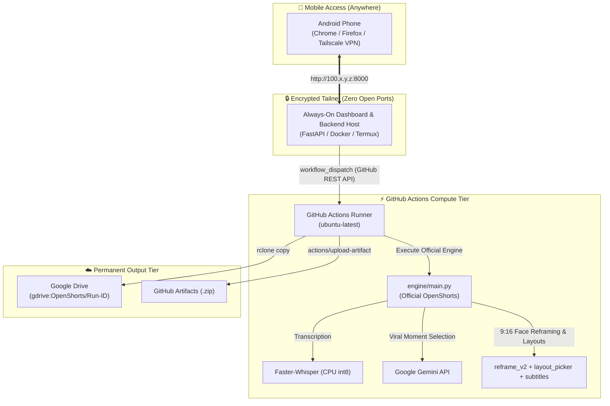

# ⚡ OpenShorts Automation with Tailscale Dashboard Access

> **Turn long YouTube videos into viral 9:16 Shorts, Reels, and TikToks from your Android phone over a secure private Tailscale network, powered by the official OpenShorts processing engine on GitHub Actions and permanently stored in Google Drive.**

[](https://github.com/mutonby/openshorts)
[](LICENSE)
[](.github/workflows/openshorts.yml)
[](https://tailscale.com)
[](https://rclone.org)

---

## 🎯 Architecture

This repository couples the **genuine official [mutonby/openshorts](https://github.com/mutonby/openshorts) engine** with an always-on private mobile dashboard and cloud storage:



---

## 🔍 Verified Official OpenShorts Integration

This project directly incorporates the genuine OpenShorts codebase under `engine/`:

| Module | Upstream Source | Purpose |
| :--- | :--- | :--- |
| `engine/main.py` | [mutonby/openshorts/main.py](https://github.com/mutonby/openshorts/blob/main/main.py) | Core batch processing engine and CLI |
| `engine/reframe_v2.py` | [mutonby/openshorts/reframe_v2.py](https://github.com/mutonby/openshorts/blob/main/reframe_v2.py) | Dynamic vertical 9:16 camera reframing & face tracking |
| `engine/layout_picker.py` | [mutonby/openshorts/layout_picker.py](https://github.com/mutonby/openshorts/blob/main/layout_picker.py) | AI scene layout detection (SPLIT, TRACK, SCREENCAST) |
| `engine/split_layout.py` | [mutonby/openshorts/split_layout.py](https://github.com/mutonby/openshorts/blob/main/split_layout.py) | Two-speaker stacked layout for interviews/podcasts |
| `engine/subtitles.py` | [mutonby/openshorts/subtitles.py](https://github.com/mutonby/openshorts/blob/main/subtitles.py) | Word-synchronized ASS karaoke subtitle burner |
| `engine/hooks.py` | [mutonby/openshorts/hooks.py](https://github.com/mutonby/openshorts/blob/main/hooks.py) | AI viral hook text overlays in first seconds |
| `engine/clip_selection.py` | [mutonby/openshorts/clip_selection.py](https://github.com/mutonby/openshorts/blob/main/clip_selection.py) | Moment ranking, windowing, and score batching |
| `engine/gemini_worker.py` | [mutonby/openshorts/gemini_worker.py](https://github.com/mutonby/openshorts/blob/main/gemini_worker.py) | Google GenAI API client and prompt contracts |
| `engine/transcribe_backends.py` | [mutonby/openshorts/transcribe_backends.py](https://github.com/mutonby/openshorts/blob/main/transcribe_backends.py) | Whisper/Parakeet speech recognition backend |

---

## 🔑 Required GitHub Secrets

Set these in your repository under **Settings → Secrets and variables → Actions**:

| Secret Name | Required | Status | How to Configure |
| :--- | :---: | :---: | :--- |
| `RCLONE_CONFIG_DATA` | **Yes** | ✅ Configured | Exported from your existing `gdrive:` remote via `./scripts/export_rclone_secret.sh` |
| `GEMINI_API_KEY` | **Yes** | ⚠️ Required | Get free key from [Google AI Studio](https://aistudio.google.com/app/apikey) |
| `YT_COOKIES` | Optional | - | Netscape cookies string (if needed for bot-restricted videos) |

To set `GEMINI_API_KEY` directly from terminal:
```bash
gh secret set GEMINI_API_KEY --repo mystxnavadeep/openshorts-automation
```

---

## 🚀 Quickstart Guide

### 1. Verify Local Health & Engine
Run the diagnostic script to verify system components:
```bash
python3 scripts/check_health.py
```

### 2. Start Dashboard Host (Bound to Tailscale)
On your always-on machine, VPS, or Termux:
```bash
cp .env.example .env
# Edit .env and supply your GITHUB_TOKEN (PAT with 'workflow' scope)
pip install -r backend/requirements.txt
./backend/run.sh
```

### 3. Connect from Android
1. Open **Tailscale** on your Android phone and toggle connection to **Active**.
2. Open Chrome/Firefox on your phone and navigate to:
   ```text
   http://100.x.y.z:8000
   ```
   *(Where `100.x.y.z` is your host's Tailscale IP address)*

### 4. Submit Video & Generate Shorts
1. Paste a YouTube URL into the dashboard.
2. Select desired format (Vertical 9:16, Square, or Horizontal).
3. Tap **🚀 Dispatch GitHub Actions Workflow**.
4. The execution monitor tracks progress in real-time.
5. When complete, tap **Open Google Drive Folder ↗** to retrieve your shorts!

---

## 💻 Hardware Capabilities: CPU vs GPU

- **Standard GitHub Actions Runners (`ubuntu-latest`)**: Run on multi-core x86_64 CPUs without NVIDIA GPUs.
- **CPU Optimizations Applied**:
  - `GPU_RENDER=0`: Uses FFmpeg multi-threaded CPU rendering.
  - `TRANSCRIBE_BACKEND=whisper`: Uses `faster-whisper` with `int8` quantization.
  - `CLIP_WORKERS=1`: Avoids CPU thrashing on 2-4 vCPU runners.
  - Processing time is typically **10 to 20 minutes** for a 5-10 minute video.
- **GPU Scaling**:
  For sub-minute processing speeds, attach a self-hosted GPU runner (e.g., RunPod or local RTX GPU) and set `runs-on: [self-hosted, gpu]` in `.github/workflows/openshorts.yml`.

---

## 📁 Repository Structure

```text
openshorts-automation/
├── .github/
│   └── workflows/
│       └── openshorts.yml          # GitHub Actions workflow executing official OpenShorts
├── engine/                         # Genuine Official OpenShorts Codebase (mutonby/openshorts)
│   ├── main.py                     # Official OpenShorts CLI & batch runner
│   ├── reframe_v2.py               # Smart vertical reframing & face tracking
│   ├── layout_picker.py            # AI scene layout picker (SPLIT/TRACK)
│   ├── split_layout.py             # Two-speaker split layout
│   ├── subtitles.py                # ASS subtitle burner
│   ├── hooks.py                    # Viral hook overlay generator
│   ├── clip_selection.py           # Viral moment scoring
│   ├── gemini_worker.py            # Gemini API integration
│   ├── requirements.txt            # Official dependencies
│   └── ...                         # All official OpenShorts modules
├── backend/
│   ├── app/
│   │   ├── config.py               # Settings loader
│   │   ├── github_client.py        # GitHub Actions REST API client
│   │   ├── security.py             # URL validation & dedup
│   │   └── main.py                 # FastAPI backend & static server
│   ├── requirements.txt            # Backend dependencies
│   └── run.sh                      # Tailscale auto-discovery startup script
├── dashboard/
│   ├── index.html                  # Mobile-first Android dashboard
│   ├── css/style.css               # Obsidian glassmorphic dark theme
│   └── js/app.js                   # Frontend client logic & live polling
├── pipeline/
│   ├── requirements.txt            # Points to engine/requirements.txt
│   └── run_openshorts.py           # Official OpenShorts runner & orchestrator
├── deploy/
│   ├── Dockerfile                  # Container definition for dashboard host
│   ├── docker-compose.yml          # Docker Compose specification
│   ├── caddy/Caddyfile             # Caddy reverse proxy for MagicDNS HTTPS
│   └── nginx/nginx.conf            # Nginx config binding to Tailscale IP
├── docs/
│   ├── ARCHITECTURE.md             # In-depth audit report & performance analysis
│   ├── TAILSCALE_SETUP.md          # Complete Android & host Tailscale setup guide
│   ├── RCLONE_SETUP.md             # Google Drive rclone integration guide
│   └── SECURITY.md                 # Defense-in-depth security model
├── scripts/
│   ├── check_health.py             # System & official engine verification tool
│   └── export_rclone_secret.sh     # Safe rclone.conf to GitHub Secret exporter
├── .env.example                    # Template environment variables
├── .gitignore                      # Git ignore file
├── LICENSE                         # MIT License
└── README.md                       # Documentation
```

---

## 🔒 Security Highlights

- **Tailscale Private Mesh**: Dashboard is accessible only through your authenticated Tailnet (zero public open ports).
- **Credential Hygiene**: Neither the `GITHUB_TOKEN` nor `GEMINI_API_KEY` are ever sent to client browsers.
- **SSRF & URL Filtering**: Rejects any non-YouTube or internal loopback/metadata addresses.

---

## 📄 License

OpenShorts core application is licensed under the [MIT License](LICENSE).
Upstream source: [mutonby/openshorts](https://github.com/mutonby/openshorts).
