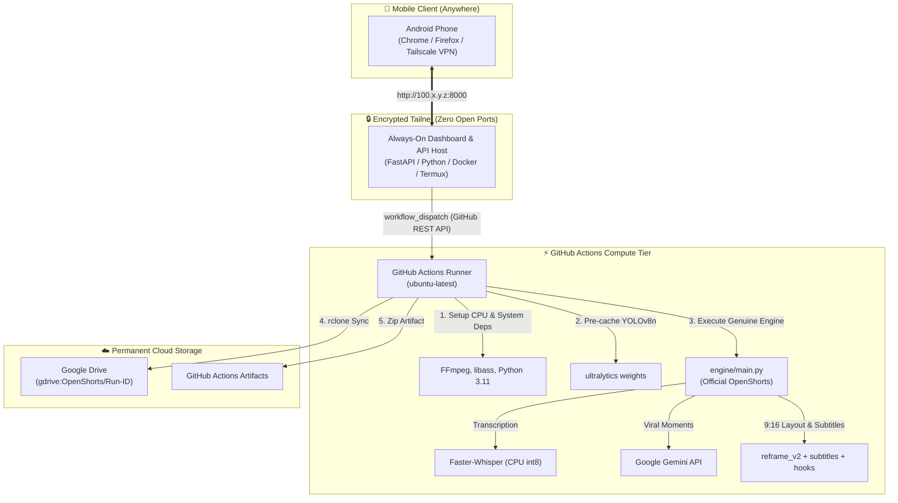

# OpenShorts Architecture & Audit Report

## 🔍 Upstream Audit: Official OpenShorts vs Custom Mock

### 1. Audit Findings
During initial repository setup, a simplified custom script (`pipeline/moment_detector.py` and `pipeline/video_processor.py`) was authored rather than embedding and executing the official [mutonby/openshorts](https://github.com/mutonby/openshorts) codebase.

**This audit directly remedies that**:
- **Deleted**: Custom mock files `pipeline/moment_detector.py` and `pipeline/video_processor.py`.
- **Integrated**: The genuine upstream OpenShorts engine was imported directly into `engine/`:
  - `engine/main.py`: Official batch execution engine and CLI.
  - `engine/reframe_v2.py`: Official 9:16 re-framing with face tracking.
  - `engine/layout_picker.py`: Official AI scene & layout picker (SPLIT, TRACK, SCREENCAST, CAMERA_INSET).
  - `engine/split_layout.py`: Official split layout for podcasts/interviews.
  - `engine/subtitles.py`: Official ASS karaoke subtitle engine.
  - `engine/hooks.py`: Official viral hook generator.
  - `engine/clip_selection.py`: Official viral moment selection and ranking.
  - `engine/gemini_worker.py`: Official Google GenAI SDK integration.
  - `engine/transcribe_backends.py`: Official transcription backend.
  - `engine/yt_clients.py`: Official YouTube client routing.
- **Orchestrated**: `pipeline/run_openshorts.py` was rewritten to serve strictly as an environment preparation layer and launcher that invokes:
  ```bash
  python3 -u engine/main.py -u "<URL>" -o "<OUTPUT_DIR>" --format "<FORMAT>"
  ```

---

## 🏗️ Architectural Topology

The system uses a decoupled 3-tier architecture:



---

## 💻 Hardware Capabilities: CPU vs GPU in GitHub Actions

### 1. GitHub-Hosted Standard Runners (`ubuntu-latest`)
Standard GitHub-hosted runners are virtual machines running on Microsoft Azure with:
- **vCPU**: 2 to 4 virtual cores (x86_64)
- **RAM**: 7 GB to 16 GB
- **GPU**: **NONE** (Standard runners do not have NVIDIA GPUs)

### 2. Can Official OpenShorts Run on CPU?
Yes. Official OpenShorts has built-in CPU fallbacks:
- **Rendering**: When `GPU_RENDER=0`, `gpu_render.py` falls back to standard multi-threaded FFmpeg CPU rendering instead of the Rust `osrender` NVENC binary.
- **Transcription**: `transcribe_backends.py` falls back to `faster-whisper` on CPU (`int8` compute type) when CUDA is unavailable.
- **Scene Detection**: `scene_detection.py` uses PyTorch CPU TransNetV2 or falls back to PySceneDetect.
- **AI Moment Picking**: Offloaded to Google Gemini API (`gemini-3.1-flash-lite` or `gemini-3.5-flash`).

### 3. Realistic Performance & Resource Expectations
- **Processing Time**: Because facial tracking (MediaPipe) and FFmpeg 9:16 reframing run on 2-4 virtual CPU cores without hardware NVENC encoding, processing a 5-10 minute video on GitHub-hosted CPU runners typically takes **10 to 20 minutes**.
- **Runner Timeout**: Set to `timeout-minutes: 180` (3 hours) in `.github/workflows/openshorts.yml` to prevent timeout termination.
- **Workers**: Set `CLIP_WORKERS=1` in the runner to avoid CPU thrashing and memory exhaustion.

---

## 🚀 Recommended Production Architecture: Self-Hosted GPU Runner

If you need sub-minute processing for long podcasts or multiple videos, attach a self-hosted GPU runner (e.g., RunPod, Lambda Labs, or a local NVIDIA RTX desktop):

1. **Install GitHub Runner on GPU host**:
   Follow GitHub's instructions under *Repository Settings → Actions → Runners*.
2. **Update Workflow**:
   In `.github/workflows/openshorts.yml`, change:
   ```yaml
   runs-on: [self-hosted, gpu]
   ```
3. **Enable GPU flags**:
   Set `GPU_RENDER: "1"` to enable NVIDIA NVENC/NVDEC hardware acceleration and `TRANSCRIBE_BACKEND: "parakeet"` for fast GPU speech recognition.
