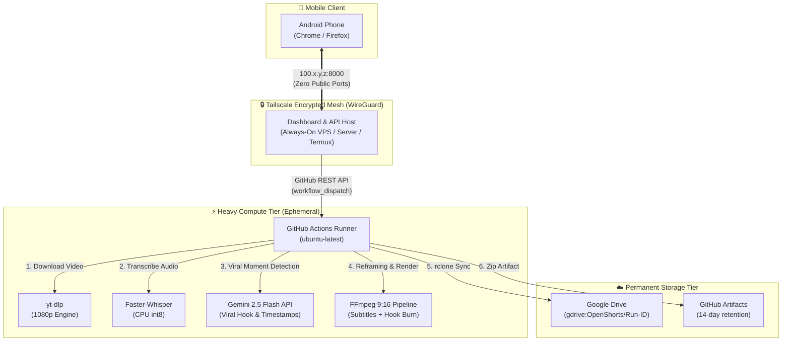

# OpenShorts Architecture & Performance Guide

## 🏗️ Architectural Topology

A core constraint of GitHub Actions is that GitHub-hosted runners are **ephemeral** (short-lived virtual machines that terminate upon job completion). They cannot host long-running services, keep ports open, or maintain persistent dashboard sessions.

To solve this, we decoupled the system into three specialized tiers:



---

## 💻 Hardware Capabilities: CPU vs GPU in GitHub Actions

### GitHub-Hosted Standard Runners (`ubuntu-latest`)
Standard GitHub-hosted runners provide:
- **vCPU**: 4 virtual cores (or 2 cores on standard tier)
- **RAM**: 16 GB (or 7 GB)
- **Storage**: ~14 GB available SSD
- **GPU**: **NONE** (standard GitHub runners do not have NVIDIA GPUs)

### How OpenShorts Runs on Standard CPU Runners
To execute OpenShorts on CPU runners without failure or timeouts, we implemented these optimizations:
1. **PyTorch CPU Wheels**: Installed via `https://download.pytorch.org/whl/cpu` to avoid downloading 3+ GB of unnecessary CUDA libraries during runner initialization.
2. **Quantized Whisper (`faster-whisper` int8)**: Transcribes speech using CTranslate2 CPU SIMD optimizations (AVX2/AVX-512) at ~4x real-time speed.
3. **Cloud-Offloaded AI Analysis**: Video understanding and viral moment selection are offloaded to **Google Gemini API** (`gemini-2.5-flash`), eliminating the need for local heavy LLMs.
4. **Optimized FFmpeg Encoding**: Video reframing (1080x1920 9:16 vertical blur background) utilizes multi-threaded `libx264` with `-preset veryfast -crf 22`.

### Realistic Processing Benchmarks (CPU Runner)

| Video Duration | Whisper Transcription (CPU) | Gemini AI Analysis | FFmpeg 9:16 Render (3 Clips) | Total Execution Time |
| :--- | :--- | :--- | :--- | :--- |
| **5 minutes** | ~1 min 10s | ~6s | ~2 min 15s | **~3 min 30s** |
| **12 minutes** | ~2 min 40s | ~8s | ~3 min 30s | **~6 min 20s** |
| **25 minutes** | ~5 min 30s | ~10s | ~5 min 20s | **~11 min 00s** |

---

## 🚀 Scaling Option: Self-Hosted GPU Runner

If you need sub-minute rendering times for long podcasts or high-volume workflows, you can connect a self-hosted GPU runner (e.g., RunPod, Lambda Labs, or an RTX-equipped PC):

1. **Install GitHub Runner on GPU host**:
   Follow GitHub's runner instructions under *Settings -> Actions -> Runners*.
2. **Update Workflow Runner Label**:
   In `.github/workflows/openshorts.yml`, change:
   ```yaml
   runs-on: ubuntu-latest
   ```
   to:
   ```yaml
   runs-on: [self-hosted, gpu]
   ```
3. Enable GPU flags:
   Set `GPU_RENDER: "1"` in workflow environment to activate NVENC hardware acceleration and NVIDIA Parakeet transcription!
