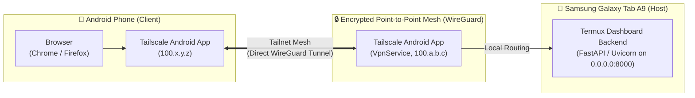

# Tailscale Deployment & Android Host Access Guide
### Samsung Galaxy Tab A9 (Termux Host) → Android Phone Access

This guide provides end-to-end instructions for deploying the OpenShorts Automation Dashboard on a **Samsung Galaxy Tab A9 X110 (Android / Termux ARM64)** and accessing it securely from an **Android phone** anywhere in the world using **Tailscale**, with **zero public port forwarding** and **zero internet exposure**.

---

## 🏗️ Architecture & How It Works on Android



### Why Tailscale Runs as an Android App on the Host
- **Android Kernel Boundary**: Non-root Android apps (like Termux) cannot create virtual network interfaces (`/dev/net/tun`) because creating network devices requires root (`CAP_NET_ADMIN`).
- **Official Solution**: The official **Tailscale Android App** (`com.tailscale.ipn`) uses Android's native `VpnService` API to establish the WireGuard tunnel at the OS level.
- **Port Binding**: The dashboard backend in Termux listens on `0.0.0.0:8000` (`INADDR_ANY`). When your phone requests `http://<tablet-tailscale-ip>:8000`, the packet arrives through the tablet's Tailscale VPN interface and is routed directly to the listening port in Termux!

---

## 📲 Part 1: Host Setup (Samsung Galaxy Tab A9)

### 1. Install & Configure Tailscale on the Tablet
1. Install **Tailscale** from [Google Play Store](https://play.google.com/store/apps/details?id=com.tailscale.ipn) or [F-Droid](https://f-droid.org/packages/com.tailscale.ipn/).
2. Log in with your Tailscale account.
3. In the Tailscale app:
   - Tap the **settings / profile icon**.
   - Ensure **"Allow incoming connections"** is enabled.
   - Toggle the main connection switch to **Active / Connected**.
4. Note your tablet's assigned Tailscale IP address (e.g., `100.85.12.34`) and MagicDNS name (e.g., `galaxy-tab-a9`).

---

### 2. Configure Termux Host Environment
Open Termux on your Samsung Tab A9 and execute:

```bash
# 1. Clone repository (if not already done)
git clone https://github.com/mystxnavadeep/openshorts-automation.git
cd openshorts-automation

# 2. Run the automated host setup script
./scripts/setup_host.sh
```

The setup script:
- Verifies Python and ARM64 architecture.
- Installs Termux-compatible dependencies (`fastapi<0.100`, `pydantic<2`, `uvicorn`, `httpx`, `python-dotenv`) using pre-built pure-Python wheels, avoiding heavy C/Rust compilation issues.
- Verifies GitHub CLI credentials.

---

### 3. Start the Dashboard Server
To start the dashboard in the background:
```bash
./scripts/start.sh
```

To verify the dashboard is running and healthy:
```bash
./scripts/status.sh
```

To run in the foreground (for debugging):
```bash
./scripts/start.sh --foreground
```

To stop the dashboard:
```bash
./scripts/stop.sh
```

---

## 🔋 Part 2: Keeping the Dashboard Running on Samsung Android

Android OS aggressively puts background apps to sleep ("Doze mode" and Samsung App Sleep). To ensure the dashboard remains accessible while the tablet is awake:

### 1. Termux CPU Wake Lock
Our `start.sh` script automatically runs `termux-wake-lock`, which holds an Android partial wake lock preventing the CPU from entering deep sleep.

### 2. Disable Samsung Battery Optimization
On your Samsung Galaxy Tab A9:
1. Open **Android Settings → Apps → Termux → Battery**.
2. Change the battery setting from **"Optimized"** to **"Unrestricted"**.
3. Open **Android Settings → Apps → Tailscale → Battery**.
4. Set Tailscale to **"Unrestricted"** as well.
5. In **Android Settings → Battery and device care → Battery → Background usage limits**:
   - Tap **"Never sleeping apps"** and add both **Termux** and **Tailscale**.
6. In **Android Settings → Apps → Termux → Mobile data / Wi-Fi**:
   - Turn **ON** "Allow background data usage".

### 3. Recovery After Device Reboot
Android does not support Linux `systemd`. When the tablet reboots:
1. Ensure Tailscale automatically reconnects (or open the Tailscale app).
2. Open Termux and run:
   ```bash
   cd ~/openshorts-automation && ./scripts/start.sh
   ```
*(Optional: Install the `Termux:Boot` companion app from F-Droid to automatically run `start.sh` on device boot).*

> [!NOTE]
> **Uptime Expectations**: Android is a consumer mobile OS, not a dedicated server OS. For true 24/7/365 continuous uptime without device battery wear, consider hosting the lightweight backend on a free/cheap Linux VPS. When hosted on the Samsung Tab A9, keep the tablet plugged in to power.

---

## 📱 Part 3: Connecting from Your Android Phone

1. Install **Tailscale** on your Android phone from [Google Play Store](https://play.google.com/store/apps/details?id=com.tailscale.ipn).
2. Log in using the **same Tailscale account** as your tablet.
3. Turn **ON** the Tailscale VPN switch.
4. Open Chrome, Firefox, or Kiwi Browser on your phone and navigate to:
   ```text
   http://100.x.y.z:8000
   ```
   *(Replace `100.x.y.z` with your Samsung Tab A9's Tailscale IP address, e.g., `http://100.85.12.34:8000`)*
   
   Or use MagicDNS:
   ```text
   http://<tablet-name>.<your-tailnet>.ts.net:8000
   ```
5. Tap Chrome menu (⋮) → **"Add to Home screen"** to install the OpenShorts dashboard as a standalone web app on your phone!

---

## 🛠️ Troubleshooting & Diagnostics

| Symptom | Cause | Solution |
| :--- | :--- | :--- |
| **"Site can't be reached" on phone** | Tailscale is inactive on phone or tablet | Open Tailscale app on both devices and verify both show green "Connected" status. |
| **Connection refused on 100.x.y.z:8000** | Dashboard is not running or listening only on 127.0.0.1 | Run `./scripts/status.sh` on tablet. Ensure server is listening on `0.0.0.0:8000`. |
| **Dashboard stops after screen turns off** | Samsung battery optimizer put Termux to sleep | Set Termux battery to **"Unrestricted"** and ensure `termux-wake-lock` was acquired. |
| **"Token required" badge in dashboard** | GitHub CLI not logged in on tablet | Run `gh auth login` in Termux, or set `GITHUB_TOKEN=ghp_...` in `.env`. |
| **GitHub dispatch fails** | Token lacks `workflow` scope | Ensure your GitHub PAT has the `workflow` permission enabled. |

---

## 🔒 Security Highlights

- **Zero Open Internet Ports**: Port 8000 is NEVER forwarded through consumer NAT routers or public firewalls.
- **Encrypted Mesh**: Traffic between your phone and tablet is encrypted peer-to-peer with WireGuard®.
- **Zero Frontend Credential Exposure**: Your GitHub PAT and Gemini API keys reside exclusively in the backend `.env` or GitHub Secrets and are NEVER delivered to the browser.
